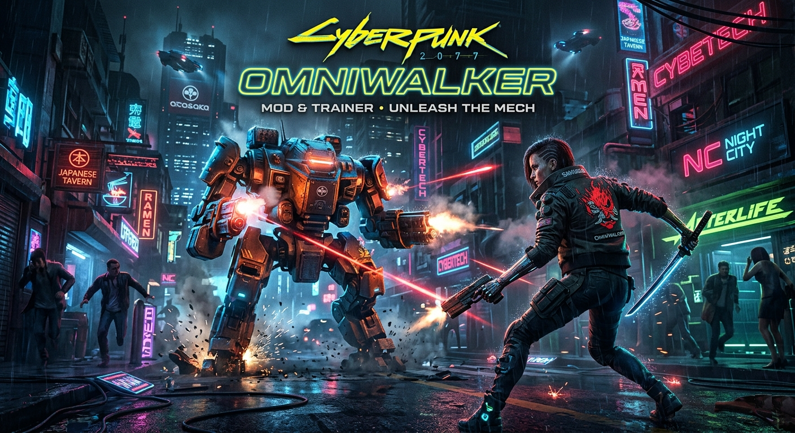

# 🌆 Cyberpunk 2077: Ultimate QoL & Customization Mod Collection

  

  

  
  
  
  

  <b>⬇ DOWNLOAD THE MOD PACK ⬇</b>

  

  
  

  

> 🌆 **Your complete toolkit for Cyberpunk 2077** — enhance AI behavior, fix visual issues, and customize your interface. Designed for **single-player offline** play. 🛡️ **NO CHEATS** — this repository contains no memory editors, aimbots, or game-breaking scripts. Only safe, client-side mods.

## 📖 About the Game

**Cyberpunk 2077** is the open-world action RPG developed by **CD PROJEKT RED**. Set in the dystopian Night City, you play as **V**, a mercenary fighting to survive in a world obsessed with power, glamour, and body modification.

With the release of **Update 2.0** and the **Phantom Liberty** expansion, the game has been completely overhauled, introducing a new perk system, police AI, cyberware capacity, and vehicle combat.

## ⚠️ IMPORTANT WARNING — READ BEFORE USING

**Cyberpunk 2077 is a single-player game with no competitive multiplayer.**

| Enforcement Risk | Details |
|------------------|---------|
| **Single-Player Safe** | No anti-cheat system for offline play |
| **Script Mods Only** | This repository contains only Redscript and CET mods — no memory injection |
| **Ban Risk** | **ZERO in single-player** — no online competitive modes |

> ⚠️ **Important**: The game has no anti-cheat. However, using **memory editors (trainers)** can corrupt your save files. This repository focuses on **safe, client-side script mods** that enhance the game without breaking it. Always back up saves before installing mods.

## 🔒 Safety & Security

| Safety Feature | Description |
|----------------|-------------|
| **No Memory Injection** | This repo contains no trainers or memory editors |
| **Redscript & CET Based** | Uses the official modding framework supported by CDPR |
| **No Network Code** | Mods contain no telemetry or online hooks |
| **Backup Recommended** | Always back up saves before installing major mods |

## 🔥 Featured Mods

### 🤖 AI Trigger Overhaul

**Source:** GitHub (ChristianFigge) | **Version:** v0.3 | **Updated:** February 6, 2026

A Redscript mod that fixes the NPC AI, making citizens less "deaf and blind" to the player's actions.

**Features**:
- **Fixes AI Stimuli** — Doors, body disposals, and radios now properly trigger NPC reactions
- **Increases Stimuli Ranges** — Categorized by loudness (customizable)
- **Fixes Odd NPC Behavior** — In Public Zones
- **Adds Sprinting Noise** — Customizable noise for walking, sprinting, jumping, and landings
- **Stealth Integration** — Sprinting noise reduction based on stealth perks (Feline Footwork & Ninjutsu)

**Requirements**: Redscript and Native Settings UI

**Installation**:
1. Install **Redscript** and **Native Settings UI**.
2. Extract the `/bin` and `/r6` folders into your game's main directory.
3. Launch the game and configure via the Mod Settings menu.

### 👁️ Kiroshi Optics - Deep Scan Protocol (Russian)

**Source:** PlayGround.ru | **Version:** 2.31 | **Updated:** June 5, 2026

A massive immersion mod that connects your Kiroshi optics to Night City's hidden databases, revealing deep lore for every NPC you scan.

**Features**:
- **230 Unique Stories** — Hand-written deep biographies for NPCs
- **1901 Procedural Events** — Random facts from citizens' harsh daily lives
- **90 Special Classifications** — And 200+ personal traits or medical diagnoses
- **320 Unique Gang Aliases** — And 300 NET accounts
- **280,000+ Name Combinations** — For 13 different ethnic groups
- **Dynamic Activation** — Only works when the eye implant is physically installed

**Requirements**: Codeware, RED4ext, Mod Settings

### 🎨 Nova Optics v1.2.1 (Russian)

**Source:** PlayGround.ru | **Version:** 1.2.1 | **Updated:** May 28, 2026

A comprehensive visual tuning mod that fixes incorrect exposure on first-person vehicles and allows precise environment adjustments.

**Features**:
- **Fixes Vehicle Exposure** — One-click fix or manual adjustment
- **Real-Time Updates** — Immediate visual feedback
- **Weather Compatible** — Works with any weather mod
- **Full Russian Translation** — All tooltips and menus translated

**Requirements**: CyberEngine Tweaks

### 🧠 Dark Future (Survival System)

**Source:** PlayGround.ru | **Version:** Russian Translation | **Updated:** March 11, 2026

A comprehensive survival overhaul mod that adds basic needs, trauma, addiction, and rebalances consumables.

**Features**:
- **Nerve System** — Your calmness affects breathing, aim, and stamina recovery
- **Basic Needs** — Hydration, nutrition, and energy meters
- **Consequences** — Low nerve causes food sickness and restless sleep; zero nerve causes a fatal heart attack
- **Customizable** — Every feature can be configured or disabled via Mod Settings

### 🛠️ Essential Modding Frameworks

| Mod | Purpose | Source |
|-----|---------|--------|
| **Redscript** | Compiles and decompiles REDengine scripts. Required for most advanced mods | jac3km4 |
| **CyberEngineTweaks (CET)** | Console and scripting framework. Required for Nova Optics and many trainers | maximegmd |
| **RED4ext** | Extends the scripting capabilities of the engine | WopsS |

## 🚀 QUICK START

### Step 1 Install Modding Frameworks

1. **Download Redscript** and extract to your game folder.
2. **Download CyberEngineTweaks (CET)** and extract to your game folder.
3. **Download RED4ext** and extract to your game folder.
4. Launch the game once to generate config folders.

### Step 2 Install Mods

1. Download the desired mods from the buttons above.
2. Extract the `.archive` or script files into your game's `archive/pc/mod` or `r6/scripts` folder.
3. Launch the game and configure via the Mod Settings menu.

## ❓ FAQ

### ❓ Is this a cheat or trainer?
**No.** This repository contains **Redscript and CET script mods** that enhance AI, visuals, and immersion. It does not include memory editors, aimbots, or game-breaking cheats.

### ❓ Will I get banned?
**No.** Cyberpunk 2077 is a single-player game with no anti-cheat. Use mods freely in offline mode.

### ❓ Does it work with the latest patch?
**Yes.** The mods listed are updated for game version **2.31** (2026).

### ❓ Does it work on Windows 11?
**Yes.** Fully compatible with Windows 10 and 11 (64-bit).

### ❓ What is Redscript?
**Redscript** is a compiler for the REDengine scripting language. It is required for most advanced Cyberpunk 2077 mods.

### ❓ What is CET?
**CyberEngineTweaks (CET)** is a console and scripting framework that allows mods to interact with the game engine.

### ❓ How to uninstall?
Delete the mod files from their respective folders. No registry changes are made.

### ❓ What if the mod doesn't work?
- Ensure Redscript and CET are updated to the latest versions.
- Check for conflicts with other mods.
- Verify the mod supports game version 2.31.

## 🛠️ System Requirements

| Component | Minimum | Recommended |
|-----------|---------|-------------|
| **OS** | Windows 10 (64-bit) | Windows 11 (64-bit) |
| **Processor** | Intel Core i5-3570K / AMD FX-8310 | Intel Core i7-4790 / AMD Ryzen 3 3200G |
| **RAM** | 8 GB | 16 GB |
| **GPU** | NVIDIA GTX 780 / AMD RX 470 | NVIDIA GTX 1060 / AMD RX 580 |
| **Storage** | 70 GB (game) + 100 MB (mods) | 70 GB SSD (game) + 100 MB (mods) |

## 📢 Disclaimer

> **Fan-made mod collection.** Not affiliated with Cyberpunk 2077 developers, CD PROJEKT RED, or any publisher.
>
> **Use at your own risk.** The author is not responsible for save corruption, crashes, or damage.
>
> **Single-player only** — use freely in offline mode.
>
> **Back up your saves before use!**

## 🌟 Support This Project

- ⭐ **Star** this repository
- 🔔 **Watch** for updates
- 🐞 **Report** issues
- 💬 **Share** with friends!

© 2026 • Cyberpunk 2077 • QoL & Customization Mods
